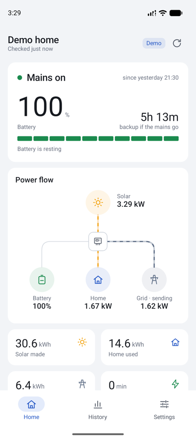
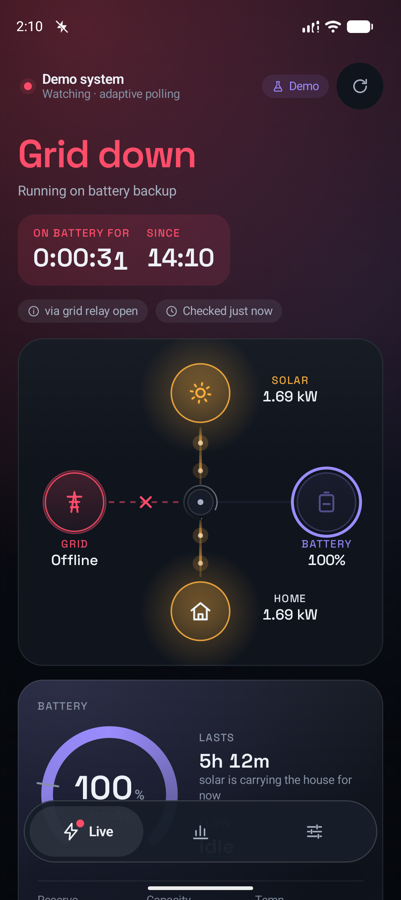
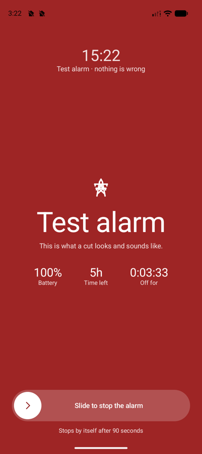
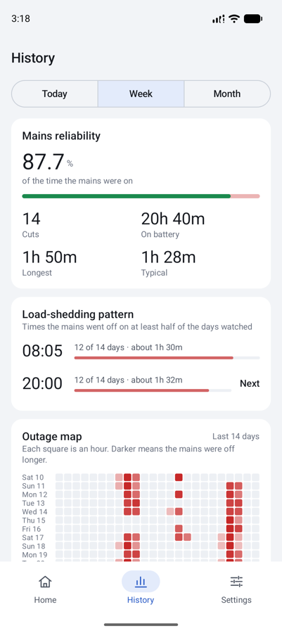
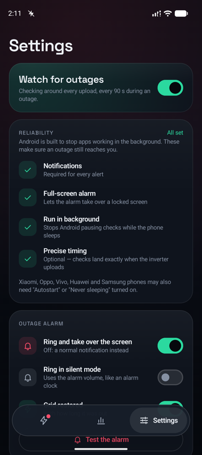
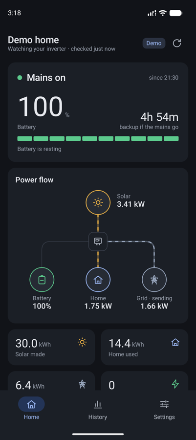
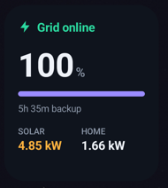
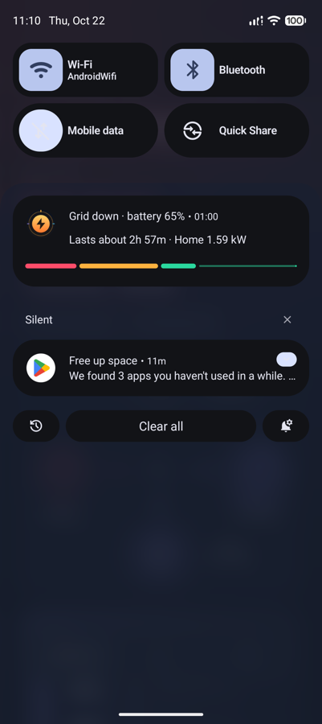

<h1 align="center">Roshni</h1>

<p align="center"><strong>Know the moment the mains go off.</strong><br>
An open-source Android app that watches your hybrid solar inverter and rings like an alarm clock when the mains fail, then tells you exactly how long your battery will last.</p>

<p align="center">
  
  
  
</p>
<p align="center">
  
  
  
</p>

---

Built for places where load-shedding is part of the day. Your inverter already switches to the battery when the mains drop; what it doesn't do is tell you. Roshni (روشنی, "light") reads the same data your inverter's Wi-Fi logger sends to the Solarman cloud, decides carefully whether the mains are really gone, and wakes you only when it matters.

## Features

**Alerts that actually reach you**
- **Full-screen outage alarm** over the lock screen, with a gentle volume ramp and a deliberate slide-to-stop. It stops on its own when the mains come back.
- **Optional ring in silent mode** using the alarm volume, like an alarm clock. **Quiet hours** turn outages into silent notifications at night, while a critical battery still rings.
- **Battery alerts**: low and critical thresholds during an outage, heavy load on battery, and an optional "battery full" nudge to run heavy appliances on spare solar.
- **System health**: inverter gone quiet, inverter fault, running hot.
- **Every alert kind has its own notification channel**, so Android's settings can silence one without silencing outages.
- **Android 16 Live Update** during an outage: a status-bar chip with the battery level, a segmented charge bar and the outage clock.
- **WhatsApp relay** (optional) so the whole household hears about it. See [`tools/whatsapp-bridge`](tools/whatsapp-bridge).

**Numbers you can trust**
- **Careful detection.** It reads the grid relay first, then grid frequency, then the voltage on every phase, then the power balance. A guess based on the power balance has to be confirmed by a second, genuinely new upload before anything rings.
- **Never claims a state from stale data.** If the logger stops uploading (often because the router isn't on backup power), the app says *Not reporting* instead of showing the last reading as current.
- **Runtime that learns your battery.** It starts from the rated capacity, then recalibrates from real discharges. Your inverter's reserve is configurable.
- **Charge time**: "full in 1h 20m" while charging.

**Insights from your own history**
- **Learned load-shedding schedule.** When outages cluster around a time of day, it predicts the next one ("~20:00, in 2h 10m, 12 of the last 14 days, usually 1h 30m") and warns you beforehand, including whether your battery should cover it.
- **Outage map**: a 14-day hour-by-hour heatmap where the schedule jumps out as columns.
- **Grid uptime**, outage count, time on battery, longest and typical outage, for today, 7 days or 30 days.
- **Day charts** of solar, home use and battery level with outages shaded. Press and drag to read values.
- **Solar production and self-sufficiency** per day.
- **CSV export** of every outage, for a spreadsheet or a complaint to your utility.

**Everywhere you look**
- Home-screen widget, Quick Settings tile and an ongoing notification.
- A **demo mode** with a simulated system and two weeks of history, so you can try everything without an inverter.
- **English and Urdu** (اردو), right to left, including alerts and the WhatsApp relay. On Android 13+ pick the language per app in system settings.
- Dark and light themes, honouring "Remove animations" and large font sizes.

<p align="center">
  
  &nbsp;&nbsp;
  
</p>

## Does it work with my inverter?

Roshni reads the cloud your inverter's Wi-Fi stick already reports to. Pick your brand under **Settings → Data source → Cloud** (or during setup); each brand asks only for what it needs.

| Brand / app | How Roshni reads it | What you need | Checked against |
|---|---|---|---|
| **Solarman** (SOLARMAN Smart / Business: Deye, Sunsynk, Sol-Ark and other hybrids with a Solarman stick) | Official OpenAPI | App ID and secret from Solarman support, plus your Solarman login | A real Deye SG05 three-phase hybrid |
| **Solarman stick on your Wi-Fi** | The stick itself (Solarman V5, local network) | The stick's IP and serial | A real Deye SG05 |
| **Growatt** (ShinePhone / ShineServer: SPH, MIN-XH, MOD-XH, SPF) | Official OpenAPI V1 with an API token; or the unofficial ShinePhone login, needed for SPF off-grid units | API token (ShineServer → Settings → Account management → API key), or your ShinePhone username and password | Only synthetic replies built from open-source clients' field names |
| **Huawei FusionSolar** (SUN2000 + LUNA2000) | Official Northbound API | An API account your installer creates (Company management → Northbound management). The kiosk link isn't enough: it has no grid or battery data | Only synthetic replies |
| **SolisCloud** | Official API, HMAC-signed | KeyID and KeySecret from soliscloud.com → API management, after a free service ticket to Solis | Only synthetic replies; the request signing matches a reference implementation |
| **SmartESS / WatchPower / DESS Monitor** (Voltronic / Axpert family: Inverex, Fronus, Knox and other rebrands) | Unofficial: the apps' own DESS Monitor API | Your SmartESS or WatchPower (Wi-Fi) username and password | Two real replies recorded by [ha-dessmonitor](https://github.com/andreas-glaser/ha-dessmonitor), plus synthetic ones for a cut |

"Only synthetic replies" means the mapping and the grid-on/off decision are unit-tested, but nobody has yet pointed Roshni at a real account of that brand. Expect rough edges there, and please report what you see.

Roshni respects each cloud's limits: Growatt is asked at most every 5 minutes (its own rule), Huawei and DESS every 2, Solis every minute, and a manual refresh inside that window reuses the last answer instead of calling again. Each cloud only refreshes as often as the Wi-Fi stick uploads, usually every 5 minutes, so an alarm can lag a cut by that much.

Metrics are found by their known key first and by their human-readable name second, so other models usually work out of the box. If yours doesn't, open **Settings → Inverter data**, copy the dump, and attach it to an issue.

## Getting started

### 1. Get Solarman OpenAPI credentials

Using another brand? The table above says what it needs; the setup screen has the same help in English and Urdu. The rest of this step is for Solarman.

The app talks to Solarman's official OpenAPI, which needs an **App ID** and **App Secret**. Solarman issues these free to plant owners on request. Contact Solarman support, say it's for monitoring your own plant, and include the email you sign in with. See Solarman's [OpenAPI FAQ](https://helpcenter.solarmanpv.com/portal/en/kb/articles/open-api-faq-summary).

Your **email and password** are the ones you already use in the Solarman app. The password is hashed with SHA-256 the moment you type it (that's what the API takes) and is stored encrypted with an Android Keystore key. It never leaves your phone except to Solarman.

### 2. Install

Download the latest `Roshni-v….apk` from [Releases](https://github.com/hafeee44-lab/Roshni/releases) and open it on your phone (Android 8 or newer). Android will ask you to allow installs from your browser or file manager the first time. Each release also lists the APK's SHA-256 so you can check the download.

Or build it yourself (see below).

### 3. Set up

The first launch walks you through it: sign in, pick your inverter from the list, then allow the three things Android needs before an alarm can reliably reach you:

| Permission | Why |
|---|---|
| Notifications | Every alert is a notification. |
| Full-screen alarm | Lets the alarm take over a locked screen. |
| Run in background | Stops Android pausing checks while the phone sleeps. |
| Precise timing *(optional)* | Checks land right after each inverter upload. |

Xiaomi, Oppo, Vivo, Huawei and Samsung phones often also need **Autostart** or **Never sleeping** turned on. [dontkillmyapp.com](https://dontkillmyapp.com) has per-brand steps.

## Building

Requirements: JDK 17+ (Android Studio's bundled JBR works) and the Android SDK with platform 37.

```bash
./gradlew assembleDebug        # app/build/outputs/apk/debug/app-debug.apk
./gradlew testDebugUnitTest    # unit tests
```

**Skip onboarding in your own builds.** Put your credentials in `local.properties`, which is gitignored and never committed. Only the password's SHA-256 is stored:

```properties
solarman.appId=...
solarman.appSecret=...
solarman.email=you@example.com
solarman.passwordSha256=...   # printf '%s' 'your-password' | shasum -a 256
solarman.deviceSn=...
```

## How it works

```
Solarman OpenAPI ──► MonitorService (foreground, alarm-chained polling, wake lock per poll)
                        │
                        ├─ GridAnalyzer      metrics → Reading → Verdict (relay / Hz / V / power balance)
                        ├─ AlertPlanner      pure: state + observation → new state, alerts, events
                        ├─ OutagePredictor   learned schedule from local history
                        └─ RuntimeEstimator  self-calibrating battery model
                        │
                        ▼
      StateStore (prefs) + HistoryDb (SQLite) ──► screens, widget, tile, notifications
```

- **Polling adapts.** It aims just after the inverter's learned upload cadence (usually every 5 minutes), polls every 90 seconds during an outage, and backs off exponentially when the cloud is unreachable. Other brands' clouds are never asked faster than their own limits allow.
- **All the decision-making is pure Kotlin with no Android dependencies**, in `domain/`, and covered by unit tests. Start there if you want to change when or how the app alerts.
- **Data stays on the phone.** There are no analytics and no accounts of our own. The only network traffic is to your inverter brand's cloud (or the stick on your Wi-Fi) and, if you set one up, your own WhatsApp bridge. Details are in the [privacy policy](docs/PRIVACY.md).

```
app/src/main/java/io/github/hafeee44lab/solargrid/
├── domain/    detection, alert planning, prediction, insights (pure + tested)
├── data/      Solarman API, other brands' clouds (data/cloud), local logger, encrypted account stores, settings, SQLite history, demo inverter
├── service/   foreground monitor, notifications, alarm player, boot receiver, QS tile
├── widget/    Glance home-screen widget
└── ui/        Compose screens, design system, charts and the power-flow diagram
```

Who it's for is in [PRODUCT.md](PRODUCT.md). Colours, type, layout and component rules are in [DESIGN.md](DESIGN.md).

## Contributing

Bug reports with an inverter dump, translations, support for more inverters and UI polish are all welcome. See [CONTRIBUTING.md](CONTRIBUTING.md).

## Privacy

No accounts, ads or analytics, and nothing reaches the developer. See the [privacy policy](docs/PRIVACY.md).

## Licence

[MIT](LICENSE).

*Not affiliated with Solarman or any inverter manufacturer.*
